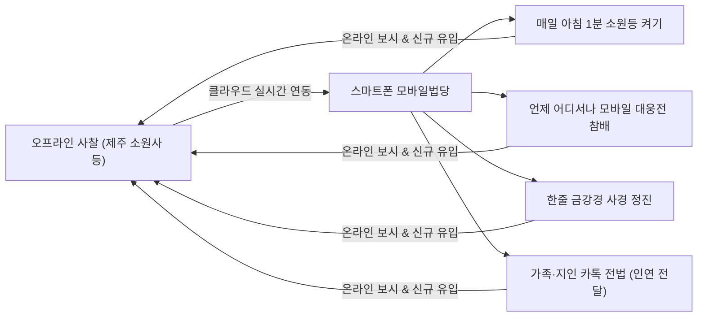

# [제안서] 차세대 사찰 모바일법당 & 스마트 종무 시스템 구축 제안서
> **내 손안의 도량, 천년의 불심을 스마트폰으로**  
> **제주 소원사 실증 성공 모델 기반 B2B 전국 사찰 보급 계획**

---

## 📌 문서 정보
- **문서명**: 차세대 사찰 모바일법당 & 원터치 스마트 종무 솔루션 도입 제안서
- **제안 기관**: 제주소원사 전국 포교위원회 / 제주AI파트너 (대표 김철수)
- **수신**: 전국 사찰 주지스님, 총무국장 스님, 종무소장 및 신도회장단 귀하
- **실증 도량 레퍼런스**: 제주 소원사 모바일법당 ([https://sowonpray.vercel.app](https://sowonpray.vercel.app))
- **실시간 체험 QR / 링크**: [모바일법당 1초 체험 바로가기](https://sowonpray.vercel.app)

---

## [표지] 내 손안의 도량, 천년의 불심을 스마트폰으로

```
┌─────────────────────────────────────────────────────────────────┐
│                                                                 │
│                 천년의 향기, 디지털 불심으로 피어나다            │
│                                                                 │
│             【 차세대 사찰 전용 모바일법당 & 스마트 종무 ERP 】      │
│                                                                 │
│   • 신도 자가 모바일 접수 (소원등·인등·백일기도·위패)              │
│   • 만세력 필요 없는 AI 사주 간지(갑자·을축) 자동 변환            │
│   • 대웅전 축원 명패 원터치 1초 무인 출력 직결                     │
│   • 매일 3분 신행 정진(소원등·참배·사경) 및 신행 공덕 시스템      │
│   • 신도가 신도를 모셔오는 카카오톡 전법(인연 전달) 추천 네트워크   │
│                                                                 │
│                제주소원사 전국 포교위원회 · 제주AI파트너           │
│                                                                 │
└─────────────────────────────────────────────────────────────────┘
```

---

## [목차 (Table of Contents)]

1. **[추진 배경]** 전국 사찰이 직면한 3대 현실적 위기와 한계
2. **[패러다임 대전환]** '찾아오는 사찰'에서 '신도의 손바닥 안에 머무는 사찰'로
3. **[4대 핵심 킬러 솔루션]** 사찰 운영의 일대 혁신
   - 킬러 ① 신도 자가 접수 & 사주 간지(갑자·을축) 자동 변환
   - 킬러 ② 종무소 일손 90% 절감: 대웅전 축원 명패 원터치 1초 출력
   - 킬러 ③ 매일 3분 신행 정진 (소원등·참배·사경) & 공덕 마일리지
   - 킬러 ④ 포교의 기적: 신도가 신도를 모셔오는 카카오톡 전법 네트워크
4. **[실증 성공 사례]** 제주 소원사 도입 성과 및 현장 반응
5. **[3분 현장 데모 시연 가이드]** 스님 스마트폰으로 1초 만에 확인하는 법
6. **[상생 도입 및 재정 모델]** 사찰의 초기 비용 부담 '0원' 파트너십
7. **[구축 로드맵 및 기대 효과]** 신청 후 7일 완성 프로세스

---

## 1. [추진 배경] 전국 사찰이 직면한 3대 현실적 위기

지금 대한민국 대다수 사찰(조계종, 태고종, 천태종, 관음종 등)은 급변하는 시대 흐름 속에서 피할 수 없는 삼중고(三重苦)를 겪고 있습니다.

```
       [신도 고령화]                    [사찰 재정 정체]                   [구형 전산 피로]
  60~80대 기존 보살님들의         초하루·보름 중심 오프라인 보시 한계       20년 전 구형 전산(두손모아 등)
  거동 불편 및 청년 세대 단절       젊은 세대의 온라인 보시 창구 부재         만세력 책 찾기와 명패 타이핑 야근
```

1. **신도 고령화와 세대 단절의 심화**
   - 평생 도량을 지켜오신 고령의 보살님들은 절을 직접 찾기 어려워지고 계시며, 30~50대 자녀 세대는 절에 방문할 시간적 여유가 없어 불교와의 인연이 끊어지고 있습니다.
2. **지리적 한계로 인한 사찰 재정의 정체**
   - 사찰을 직접 방문하는 신도들만 기도와 연등을 접수하다 보니, 도량 유지비와 불사 기금 조성이 해마다 감소하는 구조적 한계에 부딪혔습니다.
3. **20년 전 구형 전산 프로그램의 행정 피로**
   - 사찰 종무소는 여전히 2000년대 초반에 머문 구형 전산(두손모아, 모아소프트 등)을 쓰거나 종이 장부에 의존하고 있습니다.
   - 신도가 접수할 때마다 만세력 책을 뒤져 생년월일을 사주 간지로 바꾸고, 축원 명패를 일일이 워드로 타이핑하느라 초하루와 부처님오신날마다 밤샘 야근과 오타 스트레스에 시달립니다.

---

## 2. [패러다임 대전환] 신도의 일상에 머무는 365일 모바일 도량

이제 사찰은 **"신도가 절에 찾아오기만을 기다리는 사찰"**에서, **"신도가 아침에 눈떠서 잠들 때까지 손바닥 안에서 부처님을 뵙는 사찰"**로 진화해야 합니다.



- **시공간의 초월**: 서울, 부산, 미국, 유럽 등 어디에 사는 자녀라도 내 손안의 폰으로 고향 사찰에 등을 켜고 축원을 올릴 수 있습니다.
- **경건함과 편의성의 조화**: 불교의 전통적인 신행(참배, 사경, 등공양)을 스마트폰 터치 몇 번으로 누구나 경건하게 실천하도록 설계되었습니다.

---

## 3. [4대 핵심 킬러 솔루션]

### 💡 킬러 ① 신도 자가 접수 & 만세력 사주(갑자·을축) AI 자동 변환
- **신도가 집에서 스마트폰으로 직접 접수**: 이름, 생년월일(양력/음력), 주소, 발원문만 입력하고 온라인 결제/계좌 입금 완료.
- **종무소 만세력 작업 완전 자동화**: 시스템이 생년월일을 입력받는 즉시 해당 연도의 **사주 간지(예: 1974년생 ➡️ 갑인생 甲寅生)**를 오차 없이 100% 자동 산출합니다.

### 💡 킬러 ② 종무소 일손 90% 절감: 대웅전 축원 명패 원터치 1초 출력
- **수기 타이핑 제로**: 신도가 모바일로 접수한 내역은 사찰 종무소 관리자 ERP에 실시간 동기화됩니다.
- **표준 서식 원터치 인쇄**: 관리자 화면에서 `[명패 출력]` 버튼 한 번만 누르면, 사찰 대웅전 규격의 축원 명패(가족 명단, 사주, 발원 내용)가 프린터에서 즉시 인쇄되어 나옵니다.
- **결과**: 부처님오신날과 입춘/정월대보름 등 대형 법회 시즌의 종무소 업무 시간이 **수일(며칠 밤샘)에서 단 몇 분으로 단축**됩니다.

### 💡 킬러 ③ 매일 3분 신행 정진 & 공덕 마일리지 락인(Lock-in)
- **공식 5대 신행 정진 체계**:
  1. **소원등 점등** (+1,000 공덕 / 1일 1회 무료)
  2. **대웅전 참배** (+1,000 공덕 / 1일 1회)
  3. **한줄사경 정진** (+1,000 공덕 / 1일 1회)
  4. **인연 전달(전법)** (+5,000 공덕 / 1일 한도 50,000)
  5. **인연 받음** (+5,000 공덕 / 최초 1회)
- **도량 락인 효과**: 매일 쌓인 공덕 마일리지는 사찰 종무소에서 단주/염주/향 등 기념품 교환이나 특별 불사 동참 시 사용할 수 있어 신도가 매일 앱을 열어보게 만듭니다.

### 💡 킬러 ④ 포교의 기적: 카카오톡 원클릭 전법 네트워크
- 기존 신도가 가족이나 지인에게 *"우리 절 모바일법당에서 무료 소원등 하나 켜고 마음의 평안을 얻으세요"*라며 카카오톡으로 등을 선물합니다.
- 초대받은 사람이 등을 켜면 추천인과 신규 신도 모두에게 공덕이 적립되며, 타지에 있는 자녀·친척이 자연스럽게 우리 사찰의 신도로 등록됩니다.

---

## 4. [실증 성공 사례] 제주 소원사 도입 성과

```
┌───────────────────────────────────────────────────────────────────┐
│  "제주도라는 지리적 한계를 넘어 전국 2만 불자가 찾는 도량이 되었습니다" │
│                                                                   │
│  • 전국 각지 신규 신도 유입: 서울, 경기, 경상, 해외 등 전국 단위 포교망 확장 │
│  • 종무소 행정 효율성: 기도·등 접수 및 명패 작성 시간 90% 이상 획기적 단축 │
│  • 신도 만족도: 매일 아침 소원등 켜기와 사경을 통한 자발적 신행 습관 정착 │
└───────────────────────────────────────────────────────────────────┘
```

- **안전한 데이터 독립 (단독 사찰 멀티테넌트)**:
  - 다른 사찰과 신도 명부나 재정 데이터가 절대 섞이지 않는 완전 분리형 클라우드 데이터베이스(Supabase Enterprise Security)를 적용하여 사찰 고유의 자산을 철저히 보호합니다.

---

## 5. [3분 현장 데모 시연 가이드]

스님과 종무소장님을 대면하셨을 때, 긴 설명 대신 **스님의 스마트폰으로 3분 만에 끝내는 시연 프로세스**입니다.

```
[1단계] 스님 스마트폰 시연 (1분)
• 제안서 QR코드를 스님 폰 카메라로 스캔 ➡️ 모바일법당 즉시 접속
• 스님 존함과 생년월일로 [무료 소원등] 1초 만에 켜기
• ➡️ 화면에 사주 간지가 자동으로 뜨는 것을 직접 확인!

[2단계] 종무소 관리자 확인 (1분)
• 태블릿 또는 노트북 관리자 화면 제시
• ➡️ 방금 스님 폰에서 켠 소원등이 종무소 ERP에 실시간 1초 만에 접수 완료된 화면 확인!

[3단계] 대웅전 축원 명패 원터치 출력 (1분)
• 관리자 화면에서 [명패 인쇄] 버튼 원터치 클릭
• ➡️ 표준 축원 명패 양식으로 즉시 인쇄 화면이 뜨며 바로 출력되는 모습 시연!
```

> **체험용 데모 바로가기**: [https://sowonpray.vercel.app](https://sowonpray.vercel.app)  
> *(스마트폰 카메라로 아래 QR을 비추시면 즉시 체험하실 수 있습니다)*

---

## 6. [상생 도입 및 재정 모델]

사찰의 초기 재정 부담을 완전히 없앤 **2가지 맞춤형 도입 옵션**을 제안합니다.

| 구분 | **옵션 A (상생 파트너형 - 적극 추천)** | **옵션 B (단독 독립 솔루션형)** |
| :--- | :--- | :--- |
| **초기 도입비** | **0원 (무료 구축)** | **300만 원 ~ 500만 원 (1회)** |
| **유지보수비** | **0원 (월 고정비 없음)** | **월 15만 원 (서버·유지관리비)** |
| **정산 방식** | 모바일법당을 통해 유입된 **신규 온라인 기도·보시금의 합리적 수익 배분** | 온라인 보시금 100% 사찰 귀속 |
| **주요 장점** | • 사찰 부담금 제로<br>• 모바일법당 시스템 관리 및 유지보수 전담<br>• 실패 부담 없이 즉시 도입 가능 | • 완전한 사찰 단독 자산화<br>• 대형 사찰 및 재정이 풍부한 종단에 적합 |

---

## 7. [구축 로드맵 & 기대 효과]

### 🚀 신청 후 3주면 귀 사찰 맞춤형 모바일법당과 스마트 종무 ERP가 완벽히 구축됩니다.


### 🏆 도입 후 사찰이 얻게 되는 3대 결실
1. **재정 자립도 강화**: 지리적 한계를 넘어 전국 어디서나 365일 24시간 끊이지 않는 온라인 불사 보시금 유치
2. **포교의 현대화**: 젊은 자녀 세대와 손자녀까지 자연스럽게 사찰의 신도로 연결되는 청년 포교 인프라 확보
3. **종무 행정 혁신**: 며칠씩 걸리던 등 접수와 명패 인쇄 작업을 단 몇 분으로 단축하여 스님과 종무원이 본연의 기도와 수행에 전념

---

## 📞 문의 및 도입 신청

- **제안 총괄**: 제주소원사 전국 포교위원회 총괄대표 / 제주AI파트너 대표 **김철수**
- **문의 직통 전화**: 010-XXXX-XXXX (대표 직통)
- **이메일**: kcs5540@naver.com
- **온라인 데모 도량**: [https://sowonpray.vercel.app](https://sowonpray.vercel.app)

*(방문 상담을 요청하시면 담당자가 사찰을 직접 찾아뵙고 스마트폰과 노트북으로 상세 시연을 진행해 드립니다.)*
